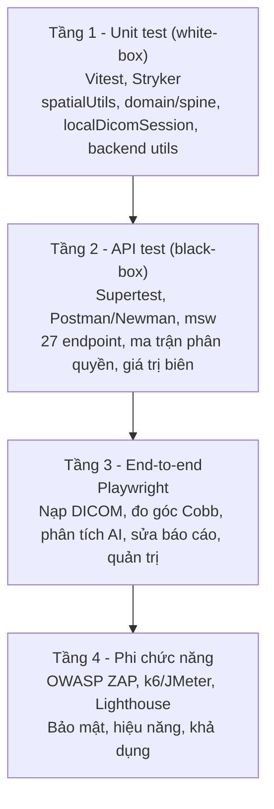

# SpineInsight-testing

Bộ kiểm thử và đánh giá chất lượng cho hệ thống **SpineInsight AI — Web-based MRI Annotation Tool for Lumbar Spine**.

| | |
|---|---|
| Môn học | Đánh giá và Kiểm định chất lượng phần mềm |
| Học kỳ | HK I, năm học 2026–2027 |
| Đơn vị | Đại học Phenikaa — Phenikaa Applied AI Lab |
| Hệ thống được kiểm thử (SUT) | [AhDuxng/SPINEINSIGHT_AI](https://github.com/AhDuxng/SPINEINSIGHT_AI) |
| Trạng thái | Khởi tạo — đang lập kế hoạch kiểm thử |

---

## 1. Mục tiêu

SpineInsight AI là hệ thống web do nhóm tự phát triển, hỗ trợ bác sĩ xem, đo đạc và chú giải ảnh MRI cột sống thắt lưng. Hệ thống tích hợp mô hình AI phân loại tổn thương theo chuẩn RSNA 2024 và tự động sinh báo cáo lâm sàng thông qua MedGemma.

Theo tài liệu audit nội bộ của dự án (`docs/02-audit/A02-gap-analysis.md`, khoảng trống G13 và sổ rủi ro P01, mục RK7), hệ thống hiện **không có bất kỳ kiểm thử tự động nào**, trong khi phần lõi hình học DICOM chứa mã chưa từng được thực thi. Đề tài này xây dựng quy trình kiểm thử hoàn chỉnh cho hệ thống, gồm bốn giai đoạn: lập kế hoạch, thiết kế test case, thực thi và báo cáo, nhằm:

1. Xác minh tính đúng đắn của các mô-đun có rủi ro cao (biến đổi toạ độ DICOM, domain model cột sống, gom series).
2. Kiểm tra toàn bộ 27 REST endpoint về chức năng, xác thực, phân quyền và xử lý lỗi.
3. Kiểm thử các luồng nghiệp vụ chính từ góc nhìn người dùng cuối.
4. Đánh giá bảo mật, hiệu năng và chất lượng tổng thể theo ISO/IEC 25010.
5. Phát hiện, ghi nhận và theo dõi lỗi thực tế; cung cấp bằng chứng định lượng về chất lượng sản phẩm.

---

## 2. Đối tượng kiểm thử

| Thành phần | Công nghệ | Quy mô |
|---|---|---|
| Frontend | React 18, TypeScript 5.7, Vite 6, zustand, Tailwind CSS, dicom-parser | ~10.600 LOC module viewer, 13 công cụ đo vẽ, 8 store |
| Backend | Node.js 20, Express 4, Supabase (PostgreSQL, RLS, audit log) | 27 endpoint, 5 nhóm route |
| Dịch vụ AI | RSNA spine model (`/predict/analyze`), MedGemma P2VG (`/api/generate-impression`) | Dịch vụ ngoài, gọi qua proxy backend |
| Triển khai | Netlify (SPA + serverless function) | — |

### 2.1. Khu vực ưu tiên kiểm thử

Danh sách dưới đây được rút ra từ việc đọc mã nguồn và tài liệu audit của SUT. Các phát hiện cần được xác nhận bằng thực thi trước khi ghi nhận là lỗi.

| STT | Khu vực | Vấn đề tiềm ẩn | Tầng kiểm thử |
|---|---|---|---|
| 1 | `frontend/src/features/viewer/utils/spatialUtils.ts` | 4/7 hàm biến đổi toạ độ chưa từng được gọi; lỗi lệch toạ độ không gây crash (RK1) | Unit |
| 2 | `backend/src/routes/studyRoutes.js` | Không có middleware xác thực; dữ liệu bệnh nhân và báo cáo có thể bị đọc/ghi bởi người chưa đăng nhập | API, Bảo mật |
| 3 | `GET /api/v1/spine/config`, `GET /api/v1/p2vg/config` | Trả về `apiKey` nội bộ cho người chưa đăng nhập | API, Bảo mật |
| 4 | `POST /api/v1/spine/analyze`, `POST /api/v1/p2vg/analyze` | Nhận tối đa 2000 file × 100 MB vào bộ nhớ, không yêu cầu xác thực | Hiệu năng, Bảo mật |
| 5 | `frontend/src/features/viewer/data/localDicomSession.ts` | Chỉ nhận file có đuôi `.dcm`; gom series theo tên thư mục thay vì SeriesInstanceUID (G10) | Unit |
| 6 | `frontend/src/features/viewer/domain/spine.ts` | Khớp series bằng so khớp chuỗi heuristic; so sánh mức độ phân biệt hoa/thường | Unit |
| 7 | Ma trận phân quyền admin / doctor / khách | RBAC gắn rời rạc ở từng route, dễ bỏ sót | API |
| 8 | `frontend/src/services/http.ts` | Interceptor refresh token từ chối các request đồng thời khi đang refresh | E2E |

---

## 3. Chiến lược kiểm thử

Kiểm thử được tổ chức theo bốn tầng, thực hiện tuần tự từ đơn vị đến hệ thống. Mỗi tầng áp dụng một nhóm kỹ thuật riêng và sinh ra báo cáo độc lập.



| Tầng | Kỹ thuật áp dụng | Công cụ | Tiêu chí hoàn thành |
|---|---|---|---|
| Unit | White-box; statement/branch coverage; mutation testing; kiểm chứng vòng tròn (round-trip); phân tích giá trị biên | Vitest, @vitest/coverage-v8, Stryker | Coverage ≥ 80% dòng, ≥ 70% nhánh trên các mô-đun trong phạm vi; mutation score ≥ 60% |
| API | Black-box; phân hoạch tương đương; bảng quyết định (vai trò × endpoint); kiểm thử tiêu cực; contract testing | Supertest, Postman + Newman, msw (mock Supabase và AI server) | 100% endpoint có ít nhất một test case dương và một test case âm |
| E2E | Kiểm thử dựa trên use case; Page Object Model; kiểm thử tương thích trình duyệt; kiểm thử song ngữ VI/EN | Playwright | 5–7 kịch bản nghiệp vụ chính chạy ổn định trên Chromium và Firefox |
| Phi chức năng | OWASP Top 10; load/stress/spike test; kiểm thử khả dụng; đánh giá theo ISO/IEC 25010 | OWASP ZAP, k6 hoặc JMeter, Lighthouse | Báo cáo ZAP không còn lỗi mức High; p95 response time có số liệu; bảng điểm ISO 25010 hoàn chỉnh |

---

## 4. Cấu trúc thư mục

```
SpineInsight-testing/
├── README.md
├── docs/                          Tài liệu kiểm thử (sản phẩm chính của môn học)
│   ├── 01-test-plan/                Test Plan theo IEEE 829 / ISO/IEC/IEEE 29119
│   ├── 02-requirements/             SRS rút gọn, Requirement Traceability Matrix (RTM)
│   ├── 03-test-cases/               Test case theo tầng, mã TC-xxx truy vết về RTM
│   ├── 04-bug-reports/              Mẫu bug report và các lỗi đã ghi nhận
│   ├── 05-test-reports/             Test Summary Report
│   └── 06-quality-assessment/       Đánh giá chất lượng theo ISO/IEC 25010
├── tests/                         Mã kiểm thử tự động
│   ├── unit/                        Tầng 1
│   │   ├── spatial/                   Biến đổi toạ độ, giao mặt phẳng, cắt biên (bộ T1–T7)
│   │   ├── domain/                    domain/spine.ts
│   │   ├── data/                      localDicomSession.ts
│   │   └── backend/                   utils và mappers của backend
│   ├── api/                         Tầng 2
│   │   ├── supertest/                 Test gọi trực tiếp Express app
│   │   ├── postman/                   Collection và environment cho Newman
│   │   └── mocks/                     msw handlers cho Supabase và AI server
│   ├── e2e/                         Tầng 3
│   │   ├── specs/                     Kịch bản kiểm thử
│   │   ├── pages/                     Page Object Model
│   │   └── fixtures/                  Tài khoản và trạng thái đăng nhập
│   └── non-functional/              Tầng 4
│       ├── security/                  Cấu hình, kết quả OWASP ZAP, checklist thủ công
│       ├── performance/               Script k6 / JMeter
│       └── accessibility/             Lighthouse, axe
├── fixtures/                      Dữ liệu kiểm thử dùng chung
│   ├── dicom/                       Ca MRI mẫu đã ẩn danh
│   ├── ai-responses/                JSON phản hồi mẫu của RSNA và P2VG server
│   └── users/                       Tài khoản seed theo vai trò
├── sut/                           Git submodule trỏ tới SPINEINSIGHT_AI
├── scripts/                       Script tiện ích (seed dữ liệu, dựng môi trường, xuất báo cáo)
├── reports/                       Báo cáo sinh tự động khi chạy test (không commit)
└── .github/workflows/             CI: chạy toàn bộ tầng test trên mỗi push
```

---

## 5. Kế hoạch thực hiện

| Giai đoạn | Thời gian | Nội dung | Sản phẩm |
|---|---|---|---|
| 0. Khởi tạo | Tuần 0 | Thống nhất phạm vi, cấu trúc repo, phân công | README, cấu trúc thư mục |
| 1. Lập kế hoạch | Tuần 1 | Test Plan, SRS rút gọn, RTM từ use case và gap analysis của SUT | `docs/01-test-plan`, `docs/02-requirements` |
| 2. Unit test | Tuần 2–3 | Thiết kế và thực thi test tầng 1; đo coverage; mutation testing | `tests/unit`, báo cáo coverage |
| 3. API test | Tuần 3–4 | Test tầng 2; dựng mock Supabase và AI server; ma trận phân quyền | `tests/api`, báo cáo Newman |
| 4. E2E | Tuần 5 | Kịch bản nghiệp vụ chính; tương thích trình duyệt | `tests/e2e`, báo cáo Playwright |
| 5. Phi chức năng | Tuần 6 | OWASP ZAP, k6, Lighthouse | `tests/non-functional`, báo cáo quét |
| 6. Tổng kết | Tuần 7 | Test Summary Report; đánh giá ISO 25010; chuẩn bị bảo vệ | `docs/05-test-reports`, `docs/06-quality-assessment` |
| Xuyên suốt | — | Ghi nhận và theo dõi vòng đời lỗi trên GitHub Issues | `docs/04-bug-reports` |

---

## 6. Quy ước

### 6.1. Mã định danh

Mã định danh dùng để truy vết chéo giữa yêu cầu, test case và lỗi.

| Loại | Định dạng | Ví dụ |
|---|---|---|
| Yêu cầu | `REQ-<nhóm>-<số>` | `REQ-AUTH-03`, `REQ-GEO-01` |
| Test case | `TC-<tầng>-<số>` | `TC-UNIT-012`, `TC-API-041`, `TC-E2E-007` |
| Lỗi | `BUG-<số>` | `BUG-014` |

### 6.2. Mức độ nghiêm trọng của lỗi

| Mức | Định nghĩa |
|---|---|
| Critical | Mất dữ liệu, lộ dữ liệu bệnh nhân, sai kết quả chẩn đoán, hệ thống không sử dụng được |
| Major | Chức năng chính sai hoặc không hoạt động, không có cách vòng tránh |
| Minor | Chức năng phụ sai, có cách vòng tránh |
| Trivial | Lỗi hiển thị, chính tả, không ảnh hưởng nghiệp vụ |

### 6.3. Quy trình Git

Nhánh làm việc theo mẫu `feature/<tầng>-<nội-dung>`. Mọi thay đổi đi qua Pull Request và được ít nhất một thành viên khác review trước khi hợp nhất vào `main`.

---

## 7. Lưu ý về dữ liệu y tế

Không commit ảnh DICOM thật của bệnh nhân vào repo. Dữ liệu kiểm thử chỉ sử dụng ca mẫu đã ẩn danh từ bộ [RSNA 2024 Lumbar Spine Degenerative Classification](https://www.kaggle.com/competitions/rsna-2024-lumbar-spine-degenerative-classification), tuân theo giấy phép phi thương mại, chỉ dùng cho mục đích nghiên cứu và giáo dục.

Tài khoản kiểm thử, API key và URL dịch vụ AI được lưu trong file `.env` (không commit). Chỉ commit `.env.example`.

---

## 8. Nhóm thực hiện

| Thành viên | Vai trò | Phụ trách |
|---|---|---|
| *(họ tên)* | Test Lead | Test Plan, RTM, tầng Unit |
| *(họ tên)* | QA Engineer | Tầng API, kiểm thử bảo mật |
| *(họ tên)* | QA Engineer | Tầng E2E, kiểm thử hiệu năng |

---

## 9. Tài liệu tham chiếu

- IEEE 829-2008 — Standard for Software and System Test Documentation
- ISO/IEC/IEEE 29119 — Software Testing
- ISO/IEC 25010:2023 — Systems and software Quality Requirements and Evaluation (SQuaRE)
- OWASP Top 10 (2021), OWASP Web Security Testing Guide
- DICOM PS3.3 C.7.6.2.1.1 — Image Position and Image Orientation (Patient)
- Tài liệu nội bộ của SUT: `docs/02-audit/A01-as-is-architecture.md`, `docs/02-audit/A02-gap-analysis.md`, `docs/04-roadmap/P01-risk-register.md`
